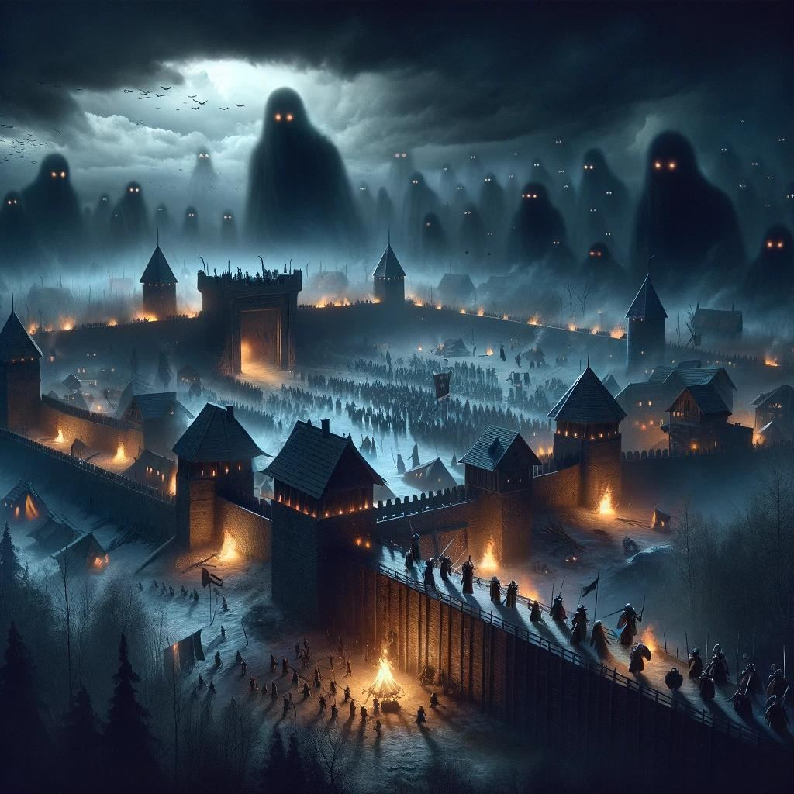

# LAST BASTION · ป้อมปราการสุดท้าย

มนุษยชาติที่เหลืออยู่ต้องสร้างฐานให้แข็งแกร่ง และป้องกันฝูงมอนสเตอร์ให้รอดครบ 5 คืน

เกมเอาชีวิตรอดมุมมอง Top-down 2D เล่นผ่านเบราว์เซอร์ทั้งคอมและมือถือ ผู้เล่นคุม Hero ออกสำรวจแผนที่ เก็บทรัพยากร สร้างฐาน และป้องกันค่ายจาก Monster

## เล่นยังไง

เปิดไฟล์ `index.html` ในเบราว์เซอร์ได้เลย ไม่ต้องติดตั้งอะไร (ต้องต่ออินเทอร์เน็ตเพื่อโหลด Phaser จาก CDN)

| การกระทำ | คอม | มือถือ |
| --- | --- | --- |
| เดิน | W A S D / ปุ่มลูกศร / คลิกที่พื้น (กดค้างเพื่อเดินตามเมาส์) | ลากนิ้วฝั่งซ้ายของจอ |
| โจมตี | อัตโนมัติเมื่อมีศัตรูในระยะ | อัตโนมัติ |
| สกิลยิงกระจาย | Q | ปุ่มวงกลมขวาล่าง |
| เก็บไม้ / หิน | ยืนติดต้นไม้หรือก้อนหิน | เหมือนกัน |
| สร้าง (กำแพง, ประตู, ป้อมธนู) / ซ่อม / ฝึกคนงาน | B แล้วเลือก คลิกวางในเขตค่าย (คลิกขวาหรือ Esc ยกเลิก) | ปุ่ม "สร้าง" แล้วแตะวาง |
| ขยายแผนที่ | M | แตะมินิแมพ |
| กลับฐาน (ยืนนิ่ง 3 วินาที) | H | ปุ่ม "กลับฐาน" ใต้มินิแมพ |
| กระเป๋า / สวมใส่ / ย่อยของ | I | ปุ่ม "กระเป๋า" ขวาล่าง |
| เก็บของดรอป | เดินทับ | เดินทับ |
| เมนู / หยุดเกม / เริ่มใหม่ | Esc | ปุ่ม "เมนู" ใต้มินิแมพ |
| เริ่มกลางคืนทันที | ปุ่ม "เริ่มกลางคืนเลย" | เหมือนกัน |

ประตูไม้: Hero และคนงานเดินผ่านได้ Monster ต้องทุบ ถ้าล้อมกำแพงรอบค่ายต้องมีประตูไม่งั้นคนงานออกไปเก็บของไม่ได้ ประตูกว้าง 2 ช่อง หมุนตามแนวกำแพงอัตโนมัติ (กด R สลับเอง) วางทับกำแพงเดิมได้เลย (ได้เลเวลเท่ากำแพงเดิม) ถ้าประตูติดหิน/ต้นไม้/น้ำจะมีเตือน

HP ฟื้นเฉพาะตอนอยู่ในเขตค่าย, Hero ล้มแล้วฟื้นที่ค่ายใน 10 วินาที

**เป้าหมาย:** กลางวัน 4 นาทีออกสำรวจ เก็บของ สร้างฐาน ก่อนค่ำ 30 วินาทีจะมีเตือนทิศที่ Monster บุก กลางคืน 2 นาทีต้องป้องกันค่ายพักแรม รอดครบ 5 คืนชนะ ค่ายพังแพ้

**กลางคืน:** Monster บุกค่ายหลายเวฟต่อคืน (คืนแรก 2 เวฟ ต่อจากนั้น 3 เวฟ) แต่ละเวฟมาคนละทิศ เวฟสุดท้ายมีบอส "ราชาซอมบี้" ที่เรียกลูกน้องได้ ล้มแล้วดรอปของ 2–3 ชิ้น อย่างน้อยระดับหายาก Monster ทั่วแผนที่ดุร้ายขึ้น (เห็นไกล วิ่งเร็ว ตีแรง) และมี Monster กลางคืนเลเวลสูงเกิดเพิ่ม ทั้งหมดโดนแดดเผาตอนเช้า

## ฐานและยูนิต (0.9)

- **คลิก/แตะสิ่งก่อสร้าง** เพื่อเปิดแผงอาคาร: อัปเกรด ซ่อม จ้างยูนิต วิจัย
- **บ้านหลัก** อัปเกรดได้ 5 เลเวล เพิ่มโควตา คนงาน 10 ต่อเลเวล (10 → 50) และ ทหารกับหมอ 5 ต่อเลเวล (5 → 25) เขตสร้าง และปลดล็อกอาคาร (Lv2: ค่ายทหาร, สถานพยาบาล · Lv3: Workshop)
- **กำแพง / ประตู** ไม้ → หิน → เหล็ก, **ป้อมธนู** 3 เลเวล (ดาเมจ x1.8 / x3) อาคารอื่นอัปได้ไม่เกินเลเวลบ้านหลัก + 1
- **โควตาแยกกัน:** คนงานนับแยกจากทหารและหมอ
- **ค่ายทหาร** จ้างพลธนู นักดาบ สั่ง "เฝ้าฐาน" หรือ "ตาม Hero"
- **สถานพยาบาล** จ้างหมอ ออกไปรักษาคนเจ็บทั้งในและนอกเมือง
- **Workshop** วิจัยอาวุธ Hero, อาวุธทหาร, เกราะทหาร อย่างละ 5 เลเวล
- **ความโหด:** Monster ในเวฟแรงขึ้น x2 ทุกคืน และแรงขึ้นทุกเวฟในคืนเดียวกัน (คืนที่ 5 แรงกว่าคืนแรก 16 เท่า) Monster ทั่วแผนที่เกิดใหม่ถี่ขึ้น

## Monster และกลางคืน (0.10)

- **Monster 100 ชนิด** แบ่ง 4 ระดับ: ต่ำ 40 · กลาง 30 · สูง 25 · บอส 5 (ดูรายการเต็มใน [docs/ART_SPEC.md](docs/ART_SPEC.md) และในเกม "สมุดมอนสเตอร์")
- พฤติกรรม 6 แบบ: เดินตี, วิ่งเร็วเป็นฝูง, ตัวถึกทุบกำแพง, **ยิงไกล** (ยิงป้อมได้), **ระเบิดตัวเอง**, **บินข้ามกำแพง**
- โซนไกลค่ายมี Monster ระดับสูงขึ้น · กลางวันเขตค่ายปลอดภัย Monster ไม่ไล่ตามเข้ามา
- กลางคืนบุกไม่หยุด: 3–6 เวฟคนละทิศ + กลุ่มเล็กแทรกตลอดคืน · บอสคืนละตัว (5 ตัววนกัน)
- **โหมดยูนิต** ตั้งแยกตามชนิดในค่ายทหาร/สถานพยาบาล: อิสระ · ตาม Hero · เฝ้าค่าย (ลาดตระเวนรอบค่าย ตีเฉพาะศัตรูที่มาทำลายค่าย)

## ทดสอบกับเพื่อน

อ่าน [PLAYTEST.md](PLAYTEST.md) สำหรับสิ่งที่อยากให้ลองและวิธีส่งความเห็น

## ความคืบหน้าต้นแบบ

- [x] ขั้น 1 – Hero เดินได้ (คีย์บอร์ด, คลิก, จอยสติ๊กบนมือถือ)
- [x] ขั้น 2 – แผนที่สุ่มจาก Seed, Fog of War, มินิแมพ, ค่ายพักแรม
- [x] ขั้น 3 – การต่อสู้: ซอมบี้, หมาป่า, ยิงอัตโนมัติ, สกิลยิงกระจาย
- [x] ขั้น 4 – ทรัพยากรและฐาน: ไม้/หิน, กำแพงไม้, ป้อมธนู, คนงานอัตโนมัติ
- [x] ขั้น 5 – กลางวัน/กลางคืนและ Wave: รอด 5 คืนชนะ, ค่ายพังแพ้, กลับฐาน, เมนูหยุดเกม
- [x] ขั้น 6 – เลเวลและของดรอป: EXP/เลเวล, ของ 3 ระดับ, สวมอาวุธ/เสื้อเกราะ, ย่อยของ
- [x] ขั้น 7 – หน้าแรก (ภาพปก, เลือก Hero, Seed), วิธีเล่น, HUD ใหม่, ภารกิจแนะนำผู้เล่นใหม่
- [x] ขั้น 8 – ปรับสมดุลด้วยบอทจำลอง, ซ่อมสิ่งก่อสร้าง, แก้คนงาน, พร้อมทดสอบ (ดู [PLAYTEST.md](PLAYTEST.md))

## โครงสร้างโค้ด

ตอนนี้ทั้งเกมอยู่ใน `index.html` ไฟล์เดียว แบ่งเป็นส่วนตามแผนพร้อม Co-op/PvP:

- `DATA` – ตัวเลขเกมทั้งหมด (อาชีพ, Monster, สิ่งก่อสร้าง, ทรัพยากร) ปรับสมดุลตรงนี้
- `Core` – ตรรกะเกมล้วน ไม่ใช้ Phaser: สร้างแผนที่, การชน, หาเส้นทาง (A*), ต่อสู้, AI, Fog of War คำนวณ 20 ครั้ง/วินาที รับคำสั่ง (`move`, `moveTo`, `skill`, `build`, `train`, `recall`, `skipDay`, `equip`, `salvage`) ภายหลังย้ายไปรันบนเซิร์ฟเวอร์ได้
- `Input` – แปลงคีย์บอร์ด/จอสัมผัสเป็นคำสั่ง
- `GameScene` – Phaser วาดภาพตามสถานะเกม
- `HUD`, `Build`, `Toast` – หน้าจอ HTML ซ้อนบนเกม

ทุก Hero, ยูนิต และอาคารมีค่า `team` และการสุ่มทั้งหมดใช้ Seed เพื่อให้ต่อเป็นออนไลน์ได้

## เทคโนโลยี

- [Phaser 4.0.0](https://phaser.io) โหลดจาก cdnjs
- ภาพจริงชุด v2 อยู่ใน `assets/art/*.webp` (ตัดจาก `assets/sheets2/` ด้วย `python3 tools/slice_sheets_v2.py assets/sheets2 build/cut2`) ภาพไหนไม่มี เกมวาดด้วยโค้ดแทนอัตโนมัติ · ต้องเปิดผ่านเว็บ (เช่น GitHub Pages หรือ `python3 -m http.server`) ภาพถึงจะโหลด
